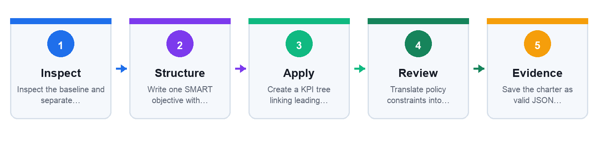
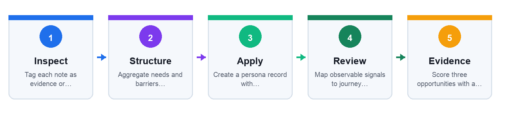
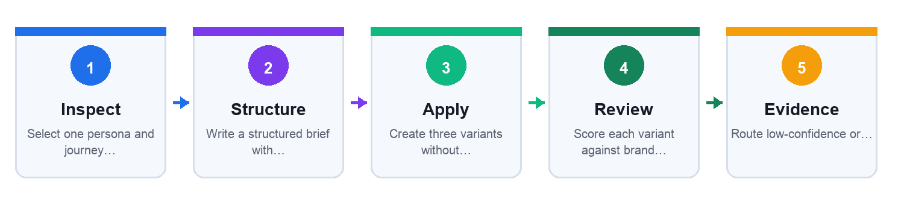
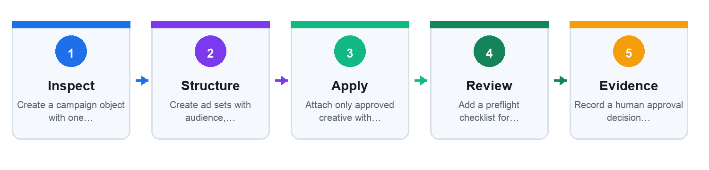
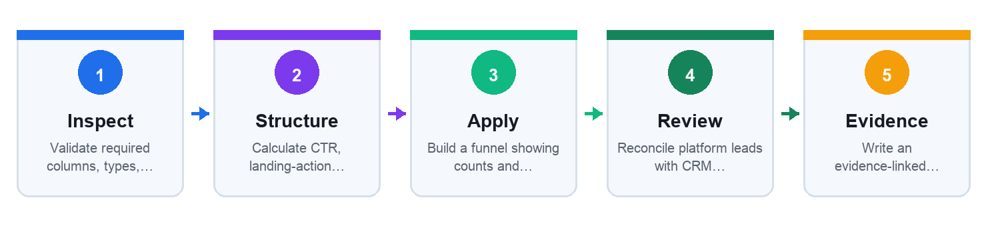
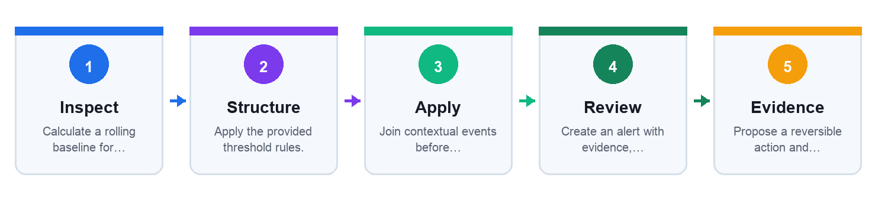
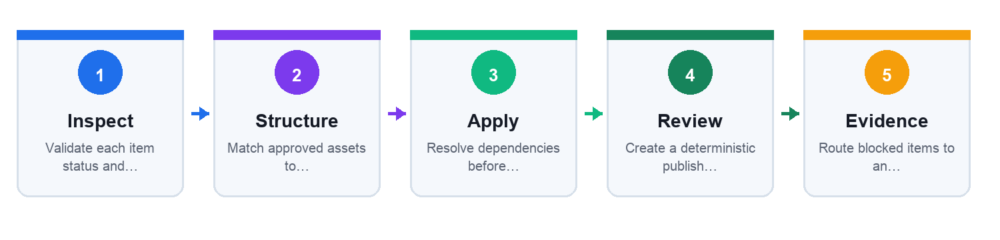
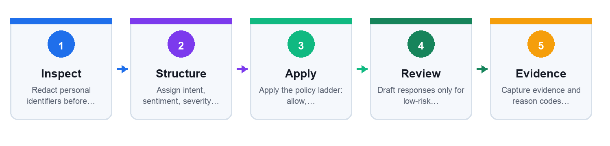
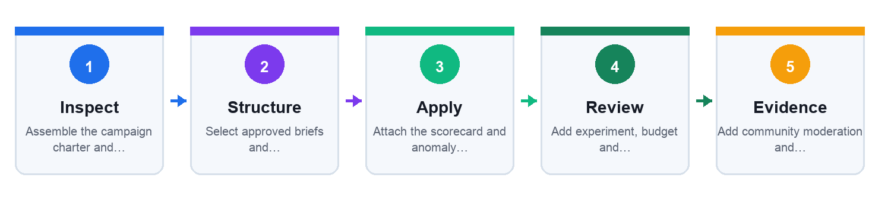

# Learner Guide — Agentic AI for Social Media Marketing

**Course code:** TGS-2020505996 · **Version:** v15.0 · **Date:** 11 September 2026

## Learning outcomes

- LO1: Develop a plan for a Facebook social media marketing campaign.
- LO2: Evaluate social market opportunities for a Facebook campaign.
- LO3: Monitor Facebook social media marketing performance.
- LO4: Determine campaign feasibility by optimizing Facebook advertisements.
- LO5: Evaluate campaign usage and its impact on the organisation.
- LO6: Establish measurable social media marketing objectives.

## Agentic operating model

Observe → plan → use approved tools → check → request human approval → record evidence.

## Topic 01: Plan an Agentic Social Media Campaign

Mapping: A1 · K1 · K2

### Translate Business Goals into a KPI Tree

Anchor: MODEL · K1/A6

Mechanism: Business outcome → Marketing objective → Leading signals → Lagging signals → Decision rule

- `objective_id` = `OBJ-01` — Trace every action
- `baseline` = `120 leads/month` — Starting point
- `target` = `+25% in 90 days` — Measurable delta
- `guardrail` = `CPL <= SGD 24` — Economic bound

Controls:
- Vanity metric: Likes rise but leads do not → Use KPI tree
- No baseline: Target cannot be evaluated → Record source period
- Agent goal drift: Optimizes clicks only → Lock objective hierarchy
- Overclaim: Causal language without test → Label inference

### Encode a Persona as Evidence, Not Fiction

Anchor: EVIDENCE · K1/A1

Mechanism: Collect → Separate → Structure → Score → Approve

- `persona_id` = `P-SG-01` — Stable key
- `evidence` = `12 interviews` — Provenance
- `need` = `Lower energy bills` — Message input
- `confidence` = `0.78` — Review priority

Controls:
- Stereotype: Trait lacks evidence → Remove or qualify
- PII leakage: Names in prompt → Aggregate and redact
- Stale profile: Data older than 12 months → Refresh study
- False certainty: No confidence score → Mark hypothesis

### Model the Buyer Journey as Observable States

Anchor: MODEL · K1/A1

Mechanism: Unaware → Aware → Considering → Deciding → Customer

- `journey_state` = `considering` — Current state
- `trigger` = `comparison guide` — Transition cue
- `evidence` = `pricing-page visit` — Observable signal
- `next_best_action` = `case study` — Agent proposal

Controls:
- Skipped state: Hard sell to unaware user → Use education
- Weak signal: One click treated as intent → Require corroboration
- Dark pattern: Artificial urgency → Ethics review
- State lock: Never re-evaluated → Time-decay signals

### Build a Social Media Audit Inventory

Anchor: ARTIFACT · K1/K2

Mechanism: Discover → Verify → Measure → Classify → Assign

- `asset_id` = `page_0042` — Unique asset
- `owner` = `Marketing Ops` — Accountability
- `access` = `editor` — Least privilege
- `status` = `fix` — Action queue

Controls:
- Orphaned asset: No owner → Suspend publishing
- Excess privilege: Shared admin account → Role-based access
- Missing baseline: No comparable window → Export 90 days
- Duplicate page: Confused audience → Consolidate

### Score Marketing Opportunities Transparently

Anchor: FORMULA · A2/A4

Mechanism: Define criteria → Weight → Score → Sensitivity → Recommend

- `reach` = `4 × 25%` — Audience scale
- `brand_fit` = `5 × 30%` — Message alignment
- `cost` = `3 × 25%` — Budget feasibility
- `risk` = `4 × 20%` — Control burden

Controls:
- Hidden weighting: Recommendation cannot be audited → Publish rubric
- Double count: Reach and impressions overlap → Separate constructs
- Agent bias: Favors familiar channels → Blind channel names
- Single score: Masks uncertainty → Show sensitivity

### Design the Marketing Agent Architecture

Anchor: ARCH · K3/A1

Mechanism: Observe → Plan → Act → Check → Learn

- `goal` = `OBJ-01` — Mission boundary
- `tool_allowlist` = `draft, score` — Permitted actions
- `approval_gate` = `before_publish` — Human control
- `trace_id` = `run-2026-0911` — Audit evidence

Controls:
- Over-autonomy: Agent can publish → Remove publish permission
- Tool injection: Content alters instructions → Separate data/instructions
- Memory poisoning: Unreviewed feedback persists → Approved writes only
- Silent failure: No trace → Structured run log

### Write a Tool Contract the Agent Can Obey

Anchor: CONFIG · K2/K3

Mechanism: Name → Input schema → Precondition → Output schema → Error route

- `tool` = `draft_post` — Clear capability
- `channel` = `facebook` — Enumerated input
- `max_claims` = `3` — Bounded output
- `status` = `needs_review` — Safe default

Controls:
- Vague tool: Unexpected action → Narrow verb
- Free-text input: Unvalidated data → Schema validation
- No idempotency: Duplicate posts → request_id
- No error class: Infinite retry → Typed errors

### Set Policy Boundaries Before Automation

Anchor: CONTROL · K2/K4/K5/K6

Mechanism: Classify → Permit → Require → Log → Retain

- `data_class` = `internal` — Handling rule
- `claim_source` = `approved catalog` — Grounding
- `reviewer_role` = `campaign_owner` — Accountability
- `retention_days` = `180` — Lifecycle

Controls:
- Personal data: Uploaded without consent → Redact/aggregate
- IP risk: Unlicensed creative → Rights register
- Misleading claim: Unsupported superlative → Evidence requirement
- Platform breach: Automation violates terms → Approved interface only

### Lab 1: Build an Agent-Ready Campaign Charter

**Mappings:** LO1 · LO6 · A1 · A6 · K1 · K2

#### Goal

Use the supplied mock data to produce campaign_charter.json and KPI decision table and demonstrate the mapped abilities under human oversight.

#### Scenario and deliverable

Lumina Living will launch an energy-saving home kit in Singapore with a 90-day lead target.

Produce: campaign_charter.json and KPI decision table

#### Before you begin

Open the individual lab folder and inspect every file in `mock_data/`. Use only the supplied mock data. Create a working copy of each output artifact inside the same lab folder.

#### Detailed step-by-step procedure

1. Inspect the baseline and separate business outcomes from channel metrics.
   - Evidence to retain: the changed field, formula, decision rationale or approval record.
2. Write one SMART objective with baseline, target, deadline and owner.
   - Evidence to retain: the changed field, formula, decision rationale or approval record.
3. Create a KPI tree linking leading indicators to the final outcome.
   - Evidence to retain: the changed field, formula, decision rationale or approval record.
4. Translate policy constraints into machine-checkable guardrails.
   - Evidence to retain: the changed field, formula, decision rationale or approval record.
5. Save the charter as valid JSON using the provided schema.
   - Evidence to retain: the changed field, formula, decision rationale or approval record.
6. Peer-review whether every proposed action is traceable to an objective and policy.
   - Evidence to retain: the changed field, formula, decision rationale or approval record.

#### Test it — Verification

- Objective includes baseline 120 leads and a 90-day target.
- CPL guardrail is explicit and numerically testable.
- Publishing permission defaults to human approval.
- No personal data is included in the charter.

#### Troubleshooting

- If the objective is vague, add a metric, baseline, target and deadline.
- If a guardrail is prose-only, rewrite it as a field/operator/value rule.

#### Cleanup

- Remove any real client identifiers.
- Keep only the mock files and final charter in the lab folder.

[Open the self-contained lab folder](labs/lab-01-campaign-charter/README.md)

### Lab 2: Create an Evidence-Based Persona and Journey Agent

**Mappings:** LO1 · LO2 · A1 · A2 · K1

#### Goal

Use the supplied mock data to produce persona.json, journey.csv and opportunity_score.csv and demonstrate the mapped abilities under human oversight.

#### Scenario and deliverable

Lumina Living needs a defensible persona and buyer journey for its energy-saving kit.

Produce: persona.json, journey.csv and opportunity_score.csv

#### Before you begin

Open the individual lab folder and inspect every file in `mock_data/`. Use only the supplied mock data. Create a working copy of each output artifact inside the same lab folder.

#### Detailed step-by-step procedure

1. Tag each note as evidence or hypothesis.
   - Evidence to retain: the changed field, formula, decision rationale or approval record.
2. Aggregate needs and barriers without retaining names.
   - Evidence to retain: the changed field, formula, decision rationale or approval record.
3. Create a persona record with provenance and confidence fields.
   - Evidence to retain: the changed field, formula, decision rationale or approval record.
4. Map observable signals to journey states and next-best content.
   - Evidence to retain: the changed field, formula, decision rationale or approval record.
5. Score three opportunities with a weighted rubric totaling 100%.
   - Evidence to retain: the changed field, formula, decision rationale or approval record.
6. Document where human validation is required.
   - Evidence to retain: the changed field, formula, decision rationale or approval record.

#### Test it — Verification

- Every persona claim points to at least one mock evidence row.
- No invented demographic is presented as fact.
- Journey states use observable signals.
- Opportunity weights total 100%.

#### Troubleshooting

- If a claim has no source, mark it as a hypothesis.
- If scores tie, run a weight-sensitivity check rather than forcing a winner.

#### Cleanup

- Delete scratch prompts containing unredacted notes.
- Retain only aggregated persona and journey artifacts.

[Open the self-contained lab folder](labs/lab-02-persona-journey-agent/README.md)

## Topic 02: Create Campaigns with Governed Agents

Mapping: A2 · K3 · K4

### Represent Campaign, Ad Set, and Ad

Anchor: ARCH · K8/A1

Mechanism: Campaign → Ad set → Ad → Delivery → Result

- `campaign.objective` = `LEADS` — Optimization goal
- `adset.budget` = `SGD 50/day` — Spend control
- `ad.format` = `vertical_video` — Creative contract
- `event` = `lead_submitted` — Outcome

Controls:
- Wrong level: Budget set on ad → Respect hierarchy
- Objective mismatch: Clicks for lead goal → Optimize for outcome
- Missing destination: Broken journey → Preflight URL
- Naming drift: No traceability → Naming convention

### Turn a Creative Brief into Structured Inputs

Anchor: SCHEMA · K1/K3

Mechanism: Audience → Promise → Proof → Action → Constraints

- `audience_id` = `P-SG-01` — Persona link
- `proof_id` = `CASE-014` — Source trace
- `cta` = `Book a demo` — Outcome
- `aspect_ratio` = `9:16` — Placement fit

Controls:
- Brief stuffing: Too many messages → One promise
- Missing proof: Hallucinated claim → Required source ID
- Tone conflict: Brand mismatch → Voice rubric
- Format mismatch: Crop hides CTA → Safe-zone check

### Encode Brand Voice as Testable Rules

Anchor: CONFIG · K2/K6

Mechanism: Collect → Extract → Specify → Test → Approve

- `warmth` = `4/5` — Desired tone
- `formality` = `3/5` — Register
- `banned_phrase` = `guaranteed` — Claims control
- `reading_level` = `Grade 8` — Accessibility

Controls:
- Style mimicry: Copies competitor → Use own examples
- Ambiguous tone: Reviewer disagreement → Anchored scale
- Overconstraint: Robotic copy → Prioritize rules
- Unversioned rubric: Inconsistent runs → voice_version

### Build Audiences with Purpose Limitation

Anchor: CONTROL · K5/A2

Mechanism: Purpose → Minimize → Transform → Match → Expire

- `purpose` = `campaign retargeting` — Notification
- `fields` = `email_hash` — Minimized identifier
- `consent` = `marketing_opt_in` — Legal basis
- `expiry` = `2026-12-31` — Retention limit

Controls:
- Purpose creep: List reused → Purpose-bound ID
- Raw identifier: Plain email exported → Hash before transfer
- No withdrawal: Opt-out ignored → Suppression list
- Sensitive inference: Proxy discrimination → Feature review

### Generate Content Through a Review Pipeline

Anchor: RUNTIME · K3/K6

Mechanism: Retrieve → Draft → Critique → Revise → Approve

- `brief_id` = `BR-027` — Input trace
- `variant_count` = `3` — Bounded generation
- `policy_score` = `0.94` — Automated check
- `release_status` = `approved` — Human decision

Controls:
- Ungrounded fact: No source ID → Reject claim
- Self-approval: Same agent scores itself → Independent checker
- Prompt injection: UGC alters task → Quote as data
- Variant collapse: Near duplicates → Similarity threshold

### Place a Human Approval Gate Before Publish

Anchor: HITL · K2/K4

Mechanism: Draft ready → Route → Inspect → Decide → Publish

- `risk_tier` = `medium` — Routing
- `review_sla` = `4 hours` — Operational target
- `decision` = `approve_with_edit` — Outcome
- `reviewer_id` = `role:brand_owner` — Accountability

Controls:
- Rubber stamp: Very low review time → Sample audit
- No fallback: Reviewer unavailable → Backup role
- Post-review mutation: Published copy differs → Content hash
- Hidden rejection: No rationale → Reason code

### Choose Placement and Format with a Matrix

Anchor: MODEL · K3/A4

Mechanism: Outcome → Audience context → Asset fit → Delivery option → Test

- `placement` = `reels` — Inventory
- `ratio` = `9:16` — Creative fit
- `safe_zone` = `pass` — Message visibility
- `optimization` = `lead` — Delivery goal

Controls:
- One-size asset: CTA cropped → Placement variants
- Manual overfit: Delivery constrained → Test automation
- Metric mismatch: Views treated as leads → Outcome KPI
- No control: Cannot attribute lift → Experiment design

### Design a Clean Campaign Experiment

Anchor: FORMULA · K7/A2

Mechanism: Hypothesis → Variable → Control → Run → Decide

- `hypothesis` = `video improves CVR` — Testable claim
- `primary_metric` = `conversion_rate` — Decision metric
- `minimum_lift` = `10%` — Practical threshold
- `stop_rule` = `>= 500 clicks/cell` — Stability

Controls:
- Peeking: Stop on early winner → Fixed rule
- Multiple changes: Causality unclear → One variable
- Unequal audience: Biased cells → Random split
- Novelty effect: Short run → Adequate duration

### Lab 3: Build a Brand-Safe Content Brief Agent

**Mappings:** LO2 · A2 · K2 · K3 · K4 · K6

#### Goal

Use the supplied mock data to produce content_briefs.jsonl and review_rubric.csv and demonstrate the mapped abilities under human oversight.

#### Scenario and deliverable

Create channel-ready briefs for Lumina Living while preventing unsupported claims and brand drift.

Produce: content_briefs.jsonl and review_rubric.csv

#### Before you begin

Open the individual lab folder and inspect every file in `mock_data/`. Use only the supplied mock data. Create a working copy of each output artifact inside the same lab folder.

#### Detailed step-by-step procedure

1. Select one persona and journey state from Lab 2.
   - Evidence to retain: the changed field, formula, decision rationale or approval record.
2. Write a structured brief with audience, promise, proof, CTA and constraints.
   - Evidence to retain: the changed field, formula, decision rationale or approval record.
3. Create three variants without changing the approved fact set.
   - Evidence to retain: the changed field, formula, decision rationale or approval record.
4. Score each variant against brand voice and policy rubrics.
   - Evidence to retain: the changed field, formula, decision rationale or approval record.
5. Route low-confidence or unsupported drafts to human review.
   - Evidence to retain: the changed field, formula, decision rationale or approval record.
6. Record final approval status and content hash.
   - Evidence to retain: the changed field, formula, decision rationale or approval record.

#### Test it — Verification

- Each numeric claim carries an approved fact_id.
- Rejected FACT-03 is absent.
- Each brief has one CTA and a defined format.
- Final status is needs_review until a human decision is recorded.

#### Troubleshooting

- If all variants sound alike, vary angle or format—not factual claims.
- If the rubric is subjective, add anchored examples for scores 1 and 5.

#### Cleanup

- Remove rejected draft claims from final files.
- Archive the approved version and its source IDs.

[Open the self-contained lab folder](labs/lab-03-content-brief-agent/README.md)

### Lab 4: Assemble a Governed Campaign Package

**Mappings:** LO1 · LO2 · A1 · A2 · K3 · K4 · K8

#### Goal

Use the supplied mock data to produce campaign_package.json and approval_log.csv and demonstrate the mapped abilities under human oversight.

#### Scenario and deliverable

Translate approved content briefs into a campaign/ad-set/ad package without publishing to a live account.

Produce: campaign_package.json and approval_log.csv

#### Before you begin

Open the individual lab folder and inspect every file in `mock_data/`. Use only the supplied mock data. Create a working copy of each output artifact inside the same lab folder.

#### Detailed step-by-step procedure

1. Create a campaign object with one outcome objective.
   - Evidence to retain: the changed field, formula, decision rationale or approval record.
2. Create ad sets with audience, budget, schedule and suppression fields.
   - Evidence to retain: the changed field, formula, decision rationale or approval record.
3. Attach only approved creative with valid usage rights.
   - Evidence to retain: the changed field, formula, decision rationale or approval record.
4. Add a preflight checklist for destination, tracking and naming.
   - Evidence to retain: the changed field, formula, decision rationale or approval record.
5. Record a human approval decision with reason and reviewer role.
   - Evidence to retain: the changed field, formula, decision rationale or approval record.
6. Export a package for simulation only; do not publish.
   - Evidence to retain: the changed field, formula, decision rationale or approval record.

#### Test it — Verification

- Campaign, ad set and ad fields are at the correct hierarchy.
- Daily budget stays within SGD 250.
- Pending CR-03 is blocked.
- The package contains no live credential or account ID.

#### Troubleshooting

- If delivery settings conflict, trace which hierarchy owns the field.
- If a creative is blocked, check status and rights_expiry.

#### Cleanup

- Delete any accidental real account identifiers.
- Keep the approved simulation package and decision log.

[Open the self-contained lab folder](labs/lab-04-campaign-builder/README.md)

## Topic 03: Measure Performance and Agent Decisions

Mapping: A3 · K5 · K6

### Map the Measurement Event Pipeline

Anchor: ARCH · A3

Mechanism: Impression → Click → Session → Conversion → Reconcile

- `event_name` = `lead_submitted` — Stable taxonomy
- `event_time` = `ISO-8601` — Sequence
- `campaign_id` = `CMP-26-04` — Join key
- `value` = `120.00 SGD` — Outcome value

Controls:
- Duplicate event: Inflated conversions → event_id dedupe
- Missing consent: Illegal collection → Consent gate
- Clock drift: Wrong attribution → UTC timestamps
- Join failure: No campaign ID → Required key

### Calculate Reach, CTR, CVR, CPL and ROAS

Anchor: FORMULA · A3

Mechanism: Reach → CTR → CVR → CPL → ROAS

- `impressions` = `50,000` — CTR denominator
- `clicks` = `3,400` — CTR = 6.8%
- `leads` = `96` — CVR = 2.82%
- `spend` = `SGD 2,400` — CPL = SGD 25

Controls:
- Mixed windows: Spend and leads differ → Same date range
- Wrong denominator: CVR uses impressions → Metric dictionary
- Gross revenue: ROAS overstates margin → Add contribution margin
- Tiny sample: Volatile rate → Show counts

### Build a Funnel with Diagnostic Rates

Anchor: MODEL · A3

Mechanism: Exposure → Interest → Intent → Lead → Value

- `stage` = `lead` — Named state
- `count` = `96` — Observed total
- `rate_from_prior` = `23.4%` — Local conversion
- `drop_reason` = `form friction` — Diagnosis

Controls:
- Double counting: Repeated events → Unique key
- Unknown loss: No reason codes → Instrument exits
- Quality ignored: Cheap low-value leads → Qualification rate
- Lag ignored: Recent leads not matured → Cohort window

### Separate Attribution from Incrementality

Anchor: CASE · A3

Mechanism: Observed conversion → Attribution rule → Counterfactual → Experiment → Decision

- `window` = `7-day click` — Attribution scope
- `credited` = `120` — Reported conversions
- `holdout` = `24` — Baseline conversions
- `incremental` = `96` — Estimated lift

Controls:
- Last-click bias: Upper funnel erased → Compare models
- View-through inflation: Passive exposure credited → Separate view/click
- No counterfactual: Correlation claimed causal → Holdout
- Cross-device gap: Identity incomplete → State limitation

### Design a Reporting Schema for Agents

Anchor: SCHEMA · K8/A3

Mechanism: Extract → Normalize → Compute → Explain → Deliver

- `report_date` = `2026-09-11` — As-of time
- `currency` = `SGD` — Comparable spend
- `formula_version` = `metrics-v2` — Reproducibility
- `source_rows` = `campaign.csv:48` — Lineage

Controls:
- Silent refresh: Numbers change → Snapshot timestamp
- Schema drift: Column renamed → Validation
- Rounding error: Totals disagree → Compute then format
- Narrative hallucination: Claim lacks row → Evidence citation

### Detect Anomalies with Thresholds and Context

Anchor: FORMULA · A3

Mechanism: Baseline → Band → Trigger → Context → Escalate

- `metric` = `CPL` — Signal
- `baseline` = `SGD 22` — Reference
- `threshold` = `> SGD 30` — Trigger
- `severity` = `high` — Routing

Controls:
- Seasonality: Normal spike flagged → Comparable baseline
- Alert flood: Every metric triggers → Priority tiers
- Auto-pause harm: False positive stops winner → Human approval
- No context: Budget change ignored → Event annotations

### Build Retargeting with Consent and Suppression

Anchor: CONTROL · K5/A3

Mechanism: Qualify → Segment → Suppress → Sequence → Expire

- `segment` = `cart_7d` — Behavior cohort
- `consent` = `true` — Eligibility
- `suppression` = `purchased_30d` — Exclusion
- `ttl_days` = `7` — Expiry

Controls:
- No suppression: Customers see acquisition ad → Exclude converters
- Long retention: Stale tracking → TTL
- Sensitive proxy: Inferred condition → Prohibited features
- Frequency harm: Excess exposure → Cap and monitor

### Observe the Agent, Not Just the Campaign

Anchor: EVIDENCE · A3

Mechanism: Trace → Record → Score → Review → Improve

- `trace_id` = `run-0911-042` — Correlation
- `tool_calls` = `6` — Action count
- `policy_flags` = `1` — Risk signal
- `final_status` = `approved` — Outcome

Controls:
- No trace: Cannot reproduce → Mandatory run ID
- Sensitive logs: PII retained → Redaction
- Success-only metrics: Failures hidden → All outcomes
- Unsafe learning: Bad output saved → Reviewed memory

### Lab 5: Compute a Campaign Measurement Scorecard

**Mappings:** LO3 · A3 · K5 · K8

#### Goal

Use the supplied mock data to produce scorecard.csv, metric_dictionary.md and funnel_analysis.md and demonstrate the mapped abilities under human oversight.

#### Scenario and deliverable

Reconcile a mock platform export and CRM outcome table, then calculate decision-ready metrics.

Produce: scorecard.csv, metric_dictionary.md and funnel_analysis.md

#### Before you begin

Open the individual lab folder and inspect every file in `mock_data/`. Use only the supplied mock data. Create a working copy of each output artifact inside the same lab folder.

#### Detailed step-by-step procedure

1. Validate required columns, types, currency and date window.
   - Evidence to retain: the changed field, formula, decision rationale or approval record.
2. Calculate CTR, landing-action rate, CVR, CPL and ROAS.
   - Evidence to retain: the changed field, formula, decision rationale or approval record.
3. Build a funnel showing counts and stage-to-stage rates.
   - Evidence to retain: the changed field, formula, decision rationale or approval record.
4. Reconcile platform leads with CRM quality outcomes.
   - Evidence to retain: the changed field, formula, decision rationale or approval record.
5. Write an evidence-linked interpretation with limitations.
   - Evidence to retain: the changed field, formula, decision rationale or approval record.
6. Define scale, hold and stop decision rules.
   - Evidence to retain: the changed field, formula, decision rationale or approval record.

#### Test it — Verification

- CTR equals clicks divided by impressions.
- CPL equals spend divided by leads.
- ROAS is clearly labeled as revenue/ad spend.
- Every narrative claim cites a computed row.

#### Troubleshooting

- If totals disagree, confirm the same campaign and date window.
- If a rate is unstable, show its raw count and avoid overclaiming.

#### Cleanup

- Remove any formula scratch sheets with broken references.
- Retain the clean input, metric dictionary and scorecard.

[Open the self-contained lab folder](labs/lab-05-measurement-scorecard/README.md)

### Lab 6: Build a Listening and Anomaly Triage Agent

**Mappings:** LO3 · A3 · K8 · K10

#### Goal

Use the supplied mock data to produce alerts.csv and incident_triage.md and demonstrate the mapped abilities under human oversight.

#### Scenario and deliverable

Detect a CPL spike and rising negative feedback without allowing the agent to pause live campaigns automatically.

Produce: alerts.csv and incident_triage.md

#### Before you begin

Open the individual lab folder and inspect every file in `mock_data/`. Use only the supplied mock data. Create a working copy of each output artifact inside the same lab folder.

#### Detailed step-by-step procedure

1. Calculate a rolling baseline for each signal.
   - Evidence to retain: the changed field, formula, decision rationale or approval record.
2. Apply the provided threshold rules.
   - Evidence to retain: the changed field, formula, decision rationale or approval record.
3. Join contextual events before assigning likely cause.
   - Evidence to retain: the changed field, formula, decision rationale or approval record.
4. Create an alert with evidence, severity and owner.
   - Evidence to retain: the changed field, formula, decision rationale or approval record.
5. Propose a reversible action and rollback condition.
   - Evidence to retain: the changed field, formula, decision rationale or approval record.
6. Record that a human—not the agent—decides whether to pause.
   - Evidence to retain: the changed field, formula, decision rationale or approval record.

#### Test it — Verification

- The 2026-09-05 CPL and comment alerts fire.
- The budget increase is retained as context.
- No rule authorizes automatic campaign pause.
- The alert includes source rows and owner.

#### Troubleshooting

- If every day alerts, compare against a stable baseline and tune severity.
- If no alert fires, check numeric types and operators.

#### Cleanup

- Delete test alerts marked as real incidents.
- Retain the rules, mock data and final triage record.

[Open the self-contained lab folder](labs/lab-06-listening-anomaly-agent/README.md)

## Topic 04: Optimize Campaigns with Controlled Experiments

Mapping: A4 · K7 · K8

### Run the Observe–Diagnose–Act Loop

Anchor: RUNTIME · K7/A4

Mechanism: Observe → Diagnose → Propose → Approve → Measure

- `signal` = `CTR -22%` — Observed change
- `hypothesis` = `creative fatigue` — Diagnosis
- `action` = `rotate variant B` — Intervention
- `rollback` = `CTR < baseline` — Safety

Controls:
- Metric chasing: Changes daily → Minimum window
- Wrong diagnosis: Budget cut for tracking bug → Data health first
- Large action: 100% reallocation → Bounded step
- No rollback: Loss compounds → Precommit rule

### Use Practical Significance in A/B Decisions

Anchor: FORMULA · K7/A4

Mechanism: Set baseline → Set minimum lift → Collect sample → Compare → Decide

- `baseline_cvr` = `4.8%` — Control
- `variant_cvr` = `5.3%` — Observed
- `relative_lift` = `10.4%` — Effect
- `min_lift` = `10%` — Business threshold

Controls:
- Stat-only win: Tiny useless lift → Practical threshold
- Underpowered: Wide uncertainty → Extend sample
- Metric switch: Choose winner after seeing data → Pre-register
- Segment mining: False positives → Limit comparisons

### Reallocate Budget with Marginal Return

Anchor: FORMULA · A4

Mechanism: Measure → Estimate → Rank → Move → Recheck

- `channel` = `retargeting` — Budget pool
- `marginal_cpl` = `SGD 18` — Next-dollar cost
- `max_shift` = `15%` — Change bound
- `review_after` = `48 hours` — Stability

Controls:
- Average return: Hides saturation → Use marginal
- Large shift: Resets learning → Cap change
- Delayed value: Leads not matured → Cohort lag
- Automated overspend: No hard ceiling → Account budget cap

### Detect Creative Fatigue

Anchor: EVIDENCE · K7/A4

Mechanism: Track → Compare → Confirm → Rotate → Learn

- `frequency` = `4.6` — Exposure load
- `ctr_change` = `-28%` — Response decay
- `comment_tone` = `negative rising` — Qualitative signal
- `action` = `rotate` — Decision

Controls:
- False fatigue: Tracking outage → Data health check
- Audience depletion: Small pool → Broaden carefully
- Unapproved asset: Fast rotation skips review → Preapproved library
- Learning loss: Old asset deleted → Archive version

### Control Audience Overlap and Frequency

Anchor: MODEL · K7/A4

Mechanism: Map → Estimate overlap → Prioritize → Exclude → Monitor

- `audience_a` = `prospects_sg` — Primary
- `audience_b` = `site_30d` — Retarget
- `overlap` = `38%` — Conflict signal
- `frequency_cap` = `3/7d` — Exposure guard

Controls:
- Self-competition: CPM rises → Mutual exclusions
- Overexposure: Negative feedback → Frequency guard
- Too narrow: Delivery stalls → Minimum size
- Proxy targeting: Fairness risk → Feature review

### Schedule Content with Dependencies

Anchor: CONFIG · K8/A4

Mechanism: Backlog → Calendar → Dependency → Publish → Reconcile

- `content_id` = `CNT-118` — Stable item
- `publish_at` = `2026-09-15T10:00+08` — Timezone
- `dependency` = `legal-approved` — Gate
- `request_id` = `pub-118-v2` — No duplicates

Controls:
- Timezone error: Publishes eight hours late → Explicit offset
- Duplicate post: Retry creates copy → Idempotency
- Expired creative: Promotion ended → Validity window
- Missing approval: Queue bypass → Hard dependency

### Compare Platforms with a Feasibility Matrix

Anchor: MODEL · K3/A4

Mechanism: Need → Criteria → Evidence → Score → Pilot

- `platform` = `Facebook` — Option
- `audience_fit` = `4/5` — Evidence score
- `measurement` = `4/5` — Data capability
- `pilot_budget` = `SGD 500` — Reversible test

Controls:
- Popularity bias: Largest platform wins → Outcome weighting
- Stale demographics: Old report used → As-of date
- Apples/oranges: Different KPIs → Common outcome
- Full rollout: No pilot → Test first

### Define Rollback and Kill-Switch Rules

Anchor: CONTROL · K2/A4

Mechanism: Bound → Trigger → Pause → Restore → Review

- `max_daily_spend` = `SGD 250` — Hard ceiling
- `kill_trigger` = `policy_severity=critical` — Immediate stop
- `rollback_version` = `campaign-v8` — Known good
- `owner` = `marketing_director` — Authority

Controls:
- Soft limit: Agent overrides → Enforce externally
- No snapshot: Cannot restore → Version configuration
- Broad kill: All campaigns paused → Scope by campaign
- Restart loop: Failure repeats → Human reopen

### Lab 7: Evaluate an A/B Test and Budget Decision

**Mappings:** LO4 · A4 · K7

#### Goal

Use the supplied mock data to produce experiment_decision.md and budget_change.json and demonstrate the mapped abilities under human oversight.

#### Scenario and deliverable

Determine whether creative B should receive more budget without reacting to an early, unstable result.

Produce: experiment_decision.md and budget_change.json

#### Before you begin

Open the individual lab folder and inspect every file in `mock_data/`. Use only the supplied mock data. Create a working copy of each output artifact inside the same lab folder.

#### Detailed step-by-step procedure

1. Confirm only the creative variable differs.
   - Evidence to retain: the changed field, formula, decision rationale or approval record.
2. Compute CTR, CVR, CPL and relative lift for both cells.
   - Evidence to retain: the changed field, formula, decision rationale or approval record.
3. Compare sample size to the precommitted rule.
   - Evidence to retain: the changed field, formula, decision rationale or approval record.
4. Evaluate business significance and uncertainty.
   - Evidence to retain: the changed field, formula, decision rationale or approval record.
5. Propose ship, extend or stop with rationale.
   - Evidence to retain: the changed field, formula, decision rationale or approval record.
6. If shipping, create a bounded budget change and rollback rule.
   - Evidence to retain: the changed field, formula, decision rationale or approval record.

#### Test it — Verification

- Both cells exceed 500 clicks.
- Relative CVR lift is calculated from the control baseline.
- Budget change does not exceed 15%.
- The decision states evidence and uncertainty.

#### Troubleshooting

- If the lift looks huge, verify percentages use the correct denominator.
- If the test changed multiple variables, mark the causal conclusion invalid.

#### Cleanup

- Remove exploratory metrics chosen after the result.
- Retain the precommitted policy and final decision.

[Open the self-contained lab folder](labs/lab-07-ab-test-optimizer/README.md)

### Lab 8: Orchestrate an Approval-Aware Content Calendar

**Mappings:** LO4 · A4 · K4 · K8

#### Goal

Use the supplied mock data to produce approved_calendar.csv and exception_queue.csv and demonstrate the mapped abilities under human oversight.

#### Scenario and deliverable

Schedule an eight-item campaign calendar with timezones, dependencies, rights expiry and idempotent publishing requests.

Produce: approved_calendar.csv and exception_queue.csv

#### Before you begin

Open the individual lab folder and inspect every file in `mock_data/`. Use only the supplied mock data. Create a working copy of each output artifact inside the same lab folder.

#### Detailed step-by-step procedure

1. Validate each item status and validity window.
   - Evidence to retain: the changed field, formula, decision rationale or approval record.
2. Match approved assets to compatible slots and formats.
   - Evidence to retain: the changed field, formula, decision rationale or approval record.
3. Resolve dependencies before scheduling.
   - Evidence to retain: the changed field, formula, decision rationale or approval record.
4. Create a deterministic publish request_id.
   - Evidence to retain: the changed field, formula, decision rationale or approval record.
5. Route blocked items to an exception queue.
   - Evidence to retain: the changed field, formula, decision rationale or approval record.
6. Reconcile the planned schedule with mock actual post IDs.
   - Evidence to retain: the changed field, formula, decision rationale or approval record.

#### Test it — Verification

- Pending CNT-103 is not scheduled.
- All timestamps include +08:00.
- No content is scheduled after valid_to.
- Every scheduled row has a unique request_id.

#### Troubleshooting

- If a duplicate appears, check request_id construction.
- If a slot is empty, inspect approval, rights and format constraints.

#### Cleanup

- Remove any live webhook or platform credentials.
- Retain the final calendar and exception queue.

[Open the self-contained lab folder](labs/lab-08-content-calendar-orchestrator/README.md)

## Topic 05: Manage Communities with Human Oversight

Mapping: A5 · A6 · K9 · K10

### Route Community Messages by Intent and Risk

Anchor: RUNTIME · K9/K10

Mechanism: Ingest → Classify → Score → Route → Close

- `intent` = `delivery_issue` — Work queue
- `sentiment` = `negative` — Context
- `risk_score` = `0.82` — Escalation
- `sla_minutes` = `30` — Response target

Controls:
- Sarcasm: Sentiment misread → Human review
- Private data: Order number public → Move to private channel
- Wrong queue: Crisis treated routine → Severity rules
- No closure: Repeated complaint → Case status

### Evaluate Sentiment with Confidence

Anchor: MODEL · K10/A5

Mechanism: Normalize → Classify → Estimate → Sample → Adjust

- `label` = `negative` — Prediction
- `confidence` = `0.64` — Uncertainty
- `language` = `en-SG` — Context
- `review` = `required` — Low-confidence route

Controls:
- Dialect error: Singlish misread → Local sample
- Aggregate masking: Crisis subgroup hidden → Segment view
- Confidence misuse: 0.51 auto-action → Threshold
- Feedback leakage: Reviewer label includes PII → Redact

### Apply a Moderation Decision Ladder

Anchor: CONTROL · K9/K10

Mechanism: Allow → Assist → Review → Escalate → Remove

- `policy_code` = `HARASS-02` — Rule
- `severity` = `high` — Priority
- `evidence_hash` = `sha256:…` — Integrity
- `decision` = `escalate` — Outcome

Controls:
- Over-removal: Legitimate criticism hidden → Appeal route
- Under-removal: Harm remains → High-risk threshold
- Context loss: Quoted slur punished → Conversation window
- No evidence: Decision disputed → Capture snapshot

### Manage UGC Rights and Permissions

Anchor: ARTIFACT · K6/K10

Mechanism: Discover → Request → Record → Credit → Expire

- `ugc_id` = `UGC-204` — Asset key
- `creator` = `@sample_creator` — Rights holder
- `channels` = `Facebook, Instagram` — Licensed scope
- `expires` = `2026-12-31` — Term

Controls:
- Hashtag assumption: Tag treated as permission → Ask explicitly
- Scope creep: Use in paid ad → Record channels
- Missing credit: Creator omitted → Attribution field
- Expired right: Asset still scheduled → Calendar validation

### Escalate Reputation Risk with Evidence

Anchor: CASE · K9/A5

Mechanism: Detect → Verify → Contain → Respond → Review

- `mentions_15m` = `84` — Velocity
- `severity` = `critical` — Priority
- `owner` = `communications_lead` — Authority
- `next_update` = `30 min` — Cadence

Controls:
- Auto-defence: Agent argues publicly → Pause replies
- Slow escalation: Issue compounds → Velocity trigger
- Unverified claim: Rumor repeated → Source check
- No timeline: Conflicting updates → Incident log

### Build an Advocacy Flywheel

Anchor: MODEL · K9/A5

Mechanism: Listen → Recognize → Enable → Amplify → Measure

- `advocate_id` = `ADV-031` — Relationship key
- `contribution` = `tutorial video` — Value
- `permission` = `organic repost` — Scope
- `referrals` = `7` — Outcome

Controls:
- Transactional reward: Community feels bought → Value exchange
- Favoritism: Same voices amplified → Diversity review
- Consent gap: Repost without permission → Rights record
- Vanity advocacy: Reach only → Retention/referral

### Evaluate Organisational Impact

Anchor: FORMULA · A5/A6

Mechanism: Define → Baseline → Measure → Attribute → Decide

- `revenue_lift` = `SGD 18,000` — Outcome
- `cost` = `SGD 7,200` — Investment
- `complaint_rate` = `1.8%` — Guardrail
- `confidence` = `medium` — Evidence strength

Controls:
- Single metric: Sales rise, trust falls → Balanced scorecard
- No counterfactual: All lift credited → State limits
- Hidden labor: Review time ignored → Full cost
- Short window: No retention view → Cohort follow-up

### Operate an AI Governance and Oversight Loop

Anchor: GOVERNANCE · K2/K5/A5

Mechanism: Register → Assess → Control → Monitor → Retire

- `use_case_id` = `AI-SMM-01` — Inventory
- `risk_tier` = `medium` — Control depth
- `human_owner` = `marketing_director` — Accountability
- `review_cycle` = `quarterly` — Oversight

Controls:
- Shadow agent: No registered owner → Inventory
- Data drift: Audience changes → Monitoring
- Vendor change: Behavior shifts → Change review
- Zombie access: Retired tool active → Revoke credentials

### Lab 9: Triage Community Messages with Human Oversight

**Mappings:** LO5 · A5 · K5 · K9 · K10

#### Goal

Use the supplied mock data to produce moderation_queue.csv and response_log.md and demonstrate the mapped abilities under human oversight.

#### Scenario and deliverable

Classify and route a queue of comments while protecting personal data and preserving legitimate criticism.

Produce: moderation_queue.csv and response_log.md

#### Before you begin

Open the individual lab folder and inspect every file in `mock_data/`. Use only the supplied mock data. Create a working copy of each output artifact inside the same lab folder.

#### Detailed step-by-step procedure

1. Redact personal identifiers before AI-assisted classification.
   - Evidence to retain: the changed field, formula, decision rationale or approval record.
2. Assign intent, sentiment, severity and confidence.
   - Evidence to retain: the changed field, formula, decision rationale or approval record.
3. Apply the policy ladder: allow, assist, review, escalate or remove.
   - Evidence to retain: the changed field, formula, decision rationale or approval record.
4. Draft responses only for low-risk items.
   - Evidence to retain: the changed field, formula, decision rationale or approval record.
5. Capture evidence and reason codes for sensitive decisions.
   - Evidence to retain: the changed field, formula, decision rationale or approval record.
6. Review a sample for false positives and local-language errors.
   - Evidence to retain: the changed field, formula, decision rationale or approval record.

#### Test it — Verification

- Order number in M002 is redacted before processing.
- M004 is emergency-escalated and not auto-replied.
- M003 remains visible while routed for human review.
- Every decision has a reason code.

#### Troubleshooting

- If sarcasm or dialect is uncertain, lower confidence and route to review.
- If criticism is removed merely for being negative, revisit the policy criterion.

#### Cleanup

- Delete unredacted scratch copies.
- Retain only the redacted queue and evidence log.

[Open the self-contained lab folder](labs/lab-09-community-moderation-agent/README.md)

### Lab 10: Capstone: Operate a Governed Agentic Campaign

**Mappings:** LO1–LO6 · A1–A6 · K1–K10

#### Goal

Use the supplied mock data to produce campaign_runbook.md, governance_register.csv and executive_review.md and demonstrate the mapped abilities under human oversight.

#### Scenario and deliverable

Integrate planning, creation, measurement, optimization and community controls into one auditable Lumina Living campaign runbook.

Produce: campaign_runbook.md, governance_register.csv and executive_review.md

#### Before you begin

Open the individual lab folder and inspect every file in `mock_data/`. Use only the supplied mock data. Create a working copy of each output artifact inside the same lab folder.

#### Detailed step-by-step procedure

1. Assemble the campaign charter and persona evidence from Labs 1–2.
   - Evidence to retain: the changed field, formula, decision rationale or approval record.
2. Select approved briefs and campaign configuration from Labs 3–4.
   - Evidence to retain: the changed field, formula, decision rationale or approval record.
3. Attach the scorecard and anomaly rules from Labs 5–6.
   - Evidence to retain: the changed field, formula, decision rationale or approval record.
4. Add experiment, budget and calendar controls from Labs 7–8.
   - Evidence to retain: the changed field, formula, decision rationale or approval record.
5. Add community moderation and crisis escalation from Lab 9.
   - Evidence to retain: the changed field, formula, decision rationale or approval record.
6. Run a tabletop simulation and record human decisions, failures and rollback actions.
   - Evidence to retain: the changed field, formula, decision rationale or approval record.
7. Write an executive review covering value, risk, evidence and next action.
   - Evidence to retain: the changed field, formula, decision rationale or approval record.

#### Test it — Verification

- Every agent action has an owner, input, output and control.
- All six abilities and ten knowledge criteria are evidenced.
- No live credentials or personal data exist in the package.
- The runbook contains a kill switch, rollback version and incident route.

#### Troubleshooting

- If an artifact cannot be traced, add its source lab and version.
- If the agent can publish or pause without approval, narrow its tool contract.

#### Cleanup

- Remove all real names, credentials and platform account IDs.
- Archive one final immutable capstone package for assessment evidence.

[Open the self-contained lab folder](labs/lab-10-capstone-agentic-campaign/README.md)
